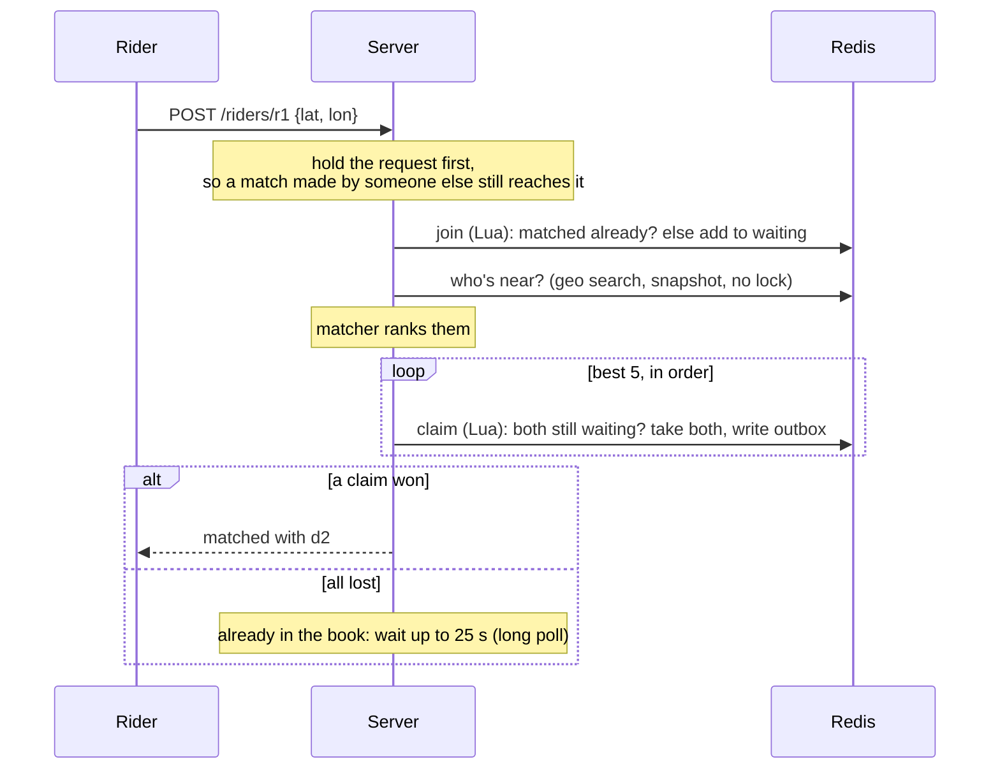

# Driver Match

*Real-time rider/driver matching on a shared Redis order book.*

A ride-matching server that treats a city like a market: riders and drivers are
two sides of one **order book**, and a match is a trade. Node.js, Express,
Redis, a few lines of Lua.

```
   riders waiting
 ┌────────────────────┐
 │ r7   12.93, 77.61  │◄──┐
 │ r9   12.97, 77.59  │   │  claim r7 + d2 in one atomic step
 └────────────────────┘   │  (r7 is nearest, so r7 is tried first)
                          │
 POST /drivers/d2  ───────┘  d2 arrives at 12.95, 77.64
```

---

## Design

Six small parts, each in its own file. Dependencies point one way only:
`server → fill → (book, matcher, delivery) → redis`.

- ***fill*** ([`src/fill.js`](src/fill.js)): the one thing a client ever does.
  A rider or driver sends their location. It matches now, or it waits. Sending
  it again is also how a client reconnects, so a timeout, a dropped connection
  and a dead server are all fixed by the same retry.
- ***book*** ([`src/book.js`](src/book.js)): the only file that knows the Redis
  keys, and the only place anything is atomic. Waiting orders are Redis geo
  sets, so distance is real kilometres. To check correctness, read this file.
- ***join***: a Lua script. "Was I already matched? If not, add me." One step,
  so nobody can match you between the question and the answer.
- ***claim***: a Lua script. "Are this rider and this driver *both* still
  waiting? Then take both." If either is gone, it fails, and the next candidate
  is tried. This is optimistic concurrency: no lock on the city.
- ***matcher*** ([`src/matchers/nearest.js`](src/matchers/nearest.js)): ranks
  candidates, closest first. It never touches state, so it can be slow, and it
  can be swapped for any other rule (or a model) without touching the rest.
- ***outbox*** and ***delivery*** ([`src/delivery.js`](src/delivery.js)): a
  match counts once it's in the outbox, written in the same step as the claim.
  Telling the clients comes after and is allowed to fail. Entries are kept, so a
  client whose connection died mid-reply finds its match on the next request.



---

## History

Each version addresses a problem in the one before it. Details are in
[`DECISIONS.md`](DECISIONS.md).

| | What changed | Problem in the previous version |
|---|---|---|
| **v0** | One Express server, everything in memory. Rider gets the nearest free driver or "none". | — |
| **v1** | Riders can wait, and poll for their match. | A rider with no driver had to keep asking by hand. |
| **v2** | Long polling: the server holds the request up to 25 s. | Polling meant seconds of delay and mostly wasted requests. |
| **v3** | Riders and drivers become two sides of one order book, sharing one `fill`. | Drivers were never told they'd been matched. |
| **v4** | The book moves into Redis; matching becomes join → rank → claim. | One process meant one CPU core, and one crash stopped the city. |

Sharding by city zone was planned, then dropped before it was built: it would
block matches across zone borders and need someone to own each shard on
failover.

---

## Performance

Load test with [`load.js`](load.js) (autocannon) against one process:

- ~8k requests/s at 10 connections, 1 ms median latency.
- CPU profile: matching logic is 4.7% of the time (the matcher itself 0.4%);
  Node's HTTP handling is 56%, Express 18%, the Redis client 8%.
- At 1000 connections throughput drops to ~1.8k req/s while Redis stays at
  20–25% CPU, so the Node process is the bottleneck.

For scale: 50k people waiting and polling every 25 s is ~2k req/s, within one
process. Running more than one server is mainly for availability.

---

## Run it

```console
$ docker compose up --build        # server on :3000, Redis alongside
```

[`play.http`](play.http) has the requests (drivers come online around MG Road
and Koramangala, a rider asks for a ride). Or by hand:

```console
$ curl -X POST localhost:3000/drivers/d1 -H 'Content-Type: application/json' -d '{"lat":12.97,"lon":77.59}'
$ curl -X POST localhost:3000/riders/r1  -H 'Content-Type: application/json' -d '{"lat":12.96,"lon":77.60}'
```

The driver's request waits; when the rider arrives, both get `matched`.
`DELETE /riders/:id` or `/drivers/:id` leaves the book.

Load test: `node load.js <connections> <seconds>` against a running server.

---

## Known limitations

The full list, with possible fixes, is in [`PROBLEMS.md`](PROBLEMS.md).

- **Under heavy load, both sides can end up waiting at the same spot.**
  Everyone ranks the same candidates the same way, so hundreds race for the same
  top 5; whoever loses all five waits until their next poll. Nothing is lost,
  but matches slow down exactly at peak.
- **Held requests live in one server's memory.** With two servers, a match made
  on one isn't pushed to a client held on the other until it polls again.
  Next step: Redis pub/sub.
- **Redis keeps everything in RAM.** If it dies, the outbox (the truth about
  matches) goes with it. It needs persistence and a replica.
- **Abandoned orders never expire**, and the 10 km search radius never grows.
- **No auth.** Anyone can send orders as any rider or driver.
